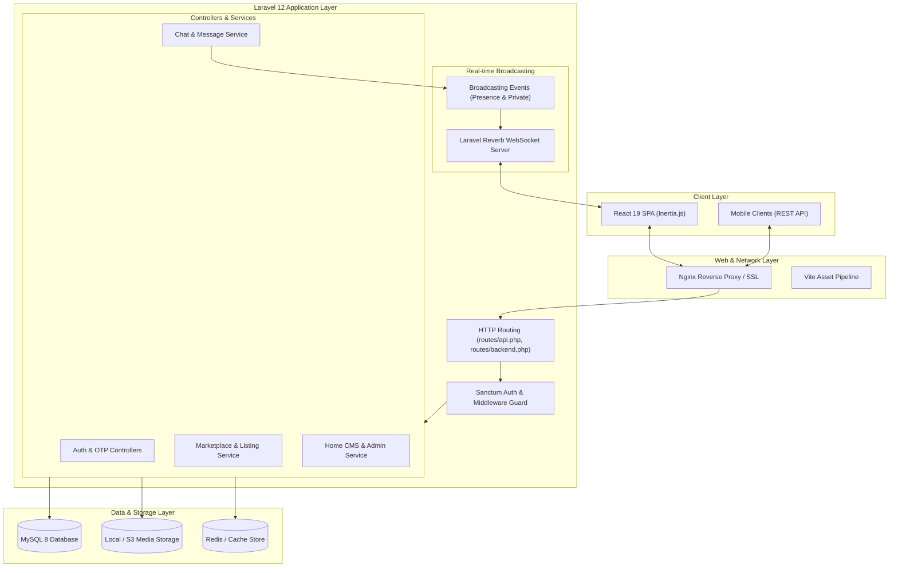
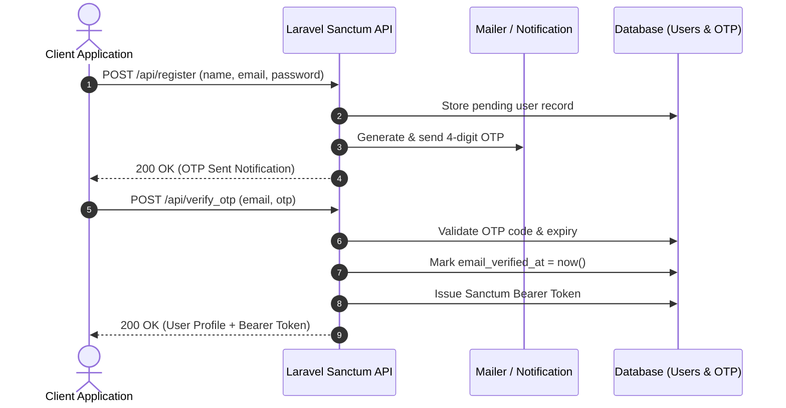
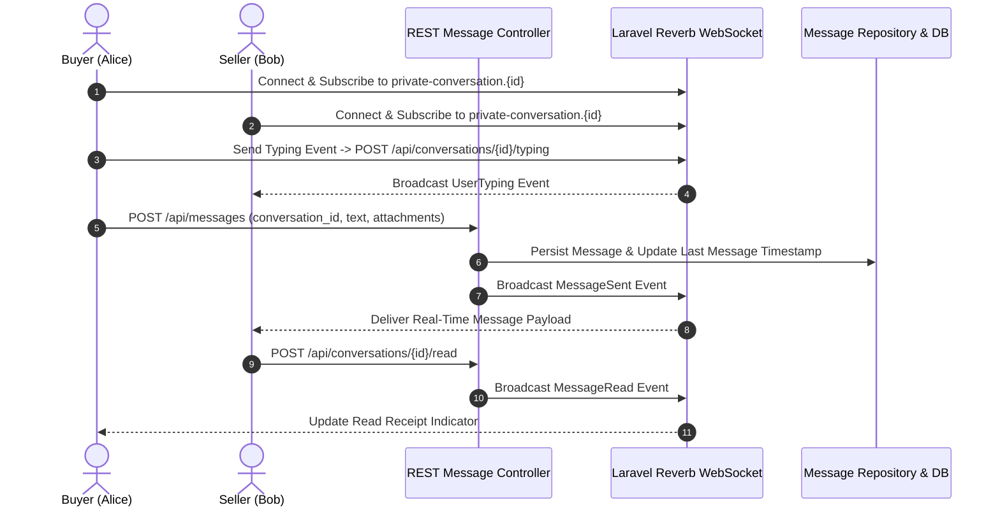
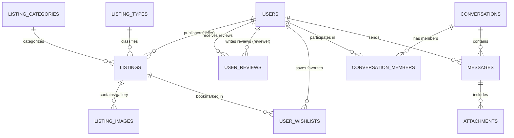

# Lokaa — Modern Local Marketplace & Real-Time Community Platform

> A full-stack, enterprise-grade marketplace and community platform connecting local consumers with trusted product and service providers, powered by Laravel 12, React 19 Inertia.js, and WebSocket real-time communication.

---

## 🛠️ Used Technologies

### Backend & Core
- **Framework:** Laravel 12.x (`laravel/framework: ^12.0`)
- **Runtime:** PHP ^8.2 (tested on PHP 8.4)
- **Architecture:** Controller-Service-Repository Pattern, API Resource Responses, Event-Driven Architecture
- **API Engine:** Laravel Sanctum (`^4.0`) with dual stateful SPA session and Bearer token authentication

### Frontend & UI
- **Single Page Application:** Inertia.js React 2.0 (`@inertiajs/react: ^2.0.0`, `inertiajs/inertia-laravel: ^2.0`)
- **View Library:** React 19 (`react: ^19.0.0`, `react-dom: ^19.0.0`)
- **Language:** TypeScript 5.7 (`typescript: ^5.7.2`)
- **Styling:** Tailwind CSS v4 (`tailwindcss: ^4.0.0`, `@tailwindcss/vite: ^4.0.6`)
- **Component Libraries:** HeroUI (`@heroui/react: ^3.0.5`), Radix UI primitives, Headless UI
- **Icons & Data Visualization:** Lucide React (`^0.475.0`), Recharts (`^3.8.1`), Lively Icons
- **Rich Text & Notifications:** React Quill New (`^3.7.0`), Sonner Toasts (`^2.0.3`)
- **Bundler:** Vite 6 (`vite: ^6.0`, `laravel-vite-plugin: ^1.0`)

### Database & Storage
- **Relational Database:** MySQL 8.0+ / MariaDB 10.4+ / SQLite (in-memory for automated tests)
- **Object/File Storage:** Laravel Filesystem (Local disk storage, AWS S3 compatible driver)
- **Caching & Sessions:** Redis / Database driver with automatic cache eviction

### Real-time & Messaging
- **WebSocket Engine:** Laravel Reverb (`laravel/reverb: ^1.10`)
- **Broadcasting Channels:** Private user channels, conversation channels, and presence online-user tracking

### Authentication & Integrations
- **OTP Verification:** Laravel OTP (`ichtrojan/laravel-otp: ^2.0`)
- **Social OAuth:** Laravel Socialite (`laravel/socialite: ^5.27`) with Google OAuth integration
- **Payment Processing:** PeptidePay Gateway API integration
- **Firebase:** Kreait Firebase PHP SDK (`kreait/firebase-php: 6.9`)

### DevOps, Quality & Tooling
- **Test Framework:** Pest PHP 3 (`pestphp/pest: ^3.8`, `pestphp/pest-plugin-laravel: ^3.2`), PHPUnit 11
- **Code Standards:** Laravel Pint (`^1.18`), ESLint 9 (`^9.17.0`), Prettier 3 (`^3.4.2`)
- **CI/CD:** Automated GitHub Actions with test runner, asset compilation, and zero-downtime SSH delivery

---

## 📖 Project Overview

### The Problem
Finding local rental equipment and trusted on-demand service providers frequently requires navigating fragmented directories, dealing with opaque pricing, and using disconnected communication channels. Service providers and equipment owners lack a unified platform to manage listings, communicate with interested clients in real time, and monitor customer satisfaction through verified reviews.

### Target Users
1. **Consumers & Renters:** Individuals searching for equipment, rentals (vehicles, tools, spaces), or local service professionals (gardening, events, technical services) with instant search, rich media, and direct messaging.
2. **Providers & Sellers:** Equipment owners and service providers seeking a streamlined dashboard to publish listings, manage availability, track engagement metrics, and converse with prospects.
3. **Platform Administrators:** Site operators needing granular control over content management (dynamic hero banners, process workflows, category showcases, hot deals, featured services), user moderation, audit logging, and customer inquiry management.

### Business Value
- **Higher Conversion & Trust:** Transparent listing structures, categorized lookup filters, direct buyer-to-seller messaging, and public review aggregations foster high user trust.
- **Dynamic Content Lifecycle:** The admin CMS empowers marketing and business operations teams to run promotions, highlight seasonal services, and customize landing page sections without developer deployments.
- **Omnichannel Readiness:** A decoupled, token-authenticated REST API allows mobile applications (iOS/Android) and third-party frontends to reuse identical marketplace and messaging services.

### Technical Highlights
- **Layered Architecture:** Strict separation of concerns leveraging Dedicated Service and Repository classes to decouple business logic from HTTP transport.
- **WebSocket Real-time Messaging:** Event-driven chat engine supporting real-time delivery, live presence tracking, typing indicators, unread badge counters, and group membership governance.
- **Granular Exception Handling:** Unified JSON error formatting ensuring sensitive stack traces are never leaked in production while maintaining standard error contracts for client applications.

---

## 🏛️ System Architecture & Workflow

### 1. Overall System Architecture



### 2. User Authentication & OTP Flow



### 3. Real-Time Messaging & Presence Flow



---

## ⚡ Key Functional Modules & Flows

### 1. Authentication & Security Module
- **Registration with OTP Verification:** Users submit credentials; the backend dispatches a timed numeric OTP via email. Upon verification, the user receives an authenticated Sanctum token.
- **Socialite Google Authentication:** Seamless sign-in through Google OAuth credentials, automatically creating accounts and linking profile avatars.
- **Password Reset:** Multi-step verification using OTP tokens prevents brute-force account takeovers.
- **Roles & Permissions:** Role-based access control (`Admin` vs `User`) enforced at the middleware layer (`AdminMiddleware`).

### 2. Marketplace & Discovery Engine
- **Hierarchical Classification:** Listings belong to high-level Listing Types (e.g., Product vs Service) and granular Categories (e.g., Tools & Equipment, Vehicles, Event & Wedding).
- **Hero Global Search:** High-performance search endpoint allowing cross-entity keyword filtering across listing titles, descriptions, categories, and geographic locations.
- **Media Management:** Multi-file upload pipeline with slugged filenames, mime-type validation, and primary image flag management.
- **Wishlist & Favorites:** Instant bookmarking with optimistic counters and dedicated collection views.
- **Seller Reviews & Reputation:** Verified buyers submit 1-5 star ratings and reviews, dynamically calculating average scores and seller reputation badges.

### 3. Real-time Communication & Collaboration
- **Direct 1-on-1 Chats:** Instant conversation initiation from any marketplace listing with automatic participant assignment.
- **Group Conversations:** Multi-user team channels with owner, admin, and member role hierarchy.
- **Live Typing & Read Status:** Throttled typing broadcast channels prevent server flooding while providing smooth UX feedback.
- **Online Presence:** Presence channel (`online-users`) dynamically tracks active user status across the application.

### 4. Admin Content Management System (Home CMS)
- **Hero Section Configuration:** Singleton editor to update the primary value proposition badge, headline, subtext, and background visual.
- **Process Steps:** Dynamic management of 3-step platform guidance cards with custom vector icons.
- **Hot Deals & Featured Services:** Flexible listing aggregators that automatically source listings by 'newest', 'featured', or explicit manual selection.
- **CTA Banners:** Dynamic call-to-action cards driving user registrations and provider conversions.
- **Legal & Dynamic Pages:** In-app rich text editor for Terms of Service, Privacy Policies, and custom policy documents.
- **Audits & Logging:** Built-in system log viewer with bulk clearing capabilities for dev/staging environments.

---

## 📂 Project Structure & API Reference

### Directory Tree

```
lokaa/
├── app/
│   ├── Events/Chat/             # Broadcast events (MessageSent, Typing, Presence)
│   ├── Helpers/                 # File upload, slug generators, and username utilities
│   ├── Http/
│   │   ├── Controllers/
│   │   │   ├── API/             # REST API controllers (Auth, Chat, Marketplace, CMS)
│   │   │   └── Web/Admin/       # Inertia.js Admin dashboard controllers
│   │   └── Middleware/          # AdminMiddleware, HandleInertiaRequests
│   ├── Models/                  # Eloquent entities (Listing, Conversation, Message, User)
│   ├── Repositories/            # Data access abstractions for Chat and Messaging
│   ├── Services/                # Business logic services (HeroSearch, Marketplace, Chat)
│   └── Traits/                  # Standardized ApiResponse, FileManager, TableAction
├── bootstrap/                   # Application bootstrapping and exception handlers
├── config/                      # Configuration files (sanctum, cors, reverb, services)
├── database/
│   ├── migrations/              # Database schema definitions
│   └── seeders/                 # Seed data for categories, CMS, and admin users
├── docs/
│   └── DEPLOYMENT.md            # Production deployment and CI/CD manual
├── resources/
│   ├── css/                     # Tailwind CSS v4 styling definitions
│   ├── js/
│   │   ├── components/          # Reusable React components (UI, Navigation, Layouts)
│   │   ├── layouts/             # App shell, Admin layout, and Auth wrappers
│   │   ├── pages/               # Inertia page views (Dashboard, Marketplace, CMS)
│   │   └── types/               # TypeScript definitions
│   └── views/                   # Root Blade template and transactional email templates
├── routes/
│   ├── api.php                  # REST API route definitions with rate limiting
│   ├── backend.php              # Inertia.js Admin dashboard routes
│   ├── channels.php             # Private and presence WebSocket broadcasting channels
│   └── web.php                  # Web session and local developer utility routes
└── tests/                       # Automated test suite (Feature, Unit, Pest PHP)
```

---

### Comprehensive REST API Reference

All API requests accept `Accept: application/json` and return a standardized JSON envelope:
```json
{
  "success": true,
  "message": "Human-readable status message.",
  "data": { ... }
}
```

#### 1. Authentication & Account API

| Method | Endpoint | Auth | Description | Request Fields / Parameters | Key Response Payload |
| :--- | :--- | :--- | :--- | :--- | :--- |
| `POST` | `/api/register` | Guest | Register new user account | `name`, `email`, `password`, `password_confirmation`, `agreeToTerms` | Success message with OTP notification |
| `POST` | `/api/verify_otp` | Guest | Verify registration OTP code | `email`, `otp` | User profile, Bearer `token` |
| `POST` | `/api/resend_otp` | Guest | Resend OTP code | `email` | Confirmation message |
| `POST` | `/api/login` | Guest | Authenticate user | `email`, `password`, `remember_token` (opt) | User profile, Bearer `token` |
| `POST` | `/api/forgot-password` | Guest | Request password reset OTP | `email` | OTP dispatch confirmation |
| `POST` | `/api/forgot-verify-otp`| Guest | Verify password reset OTP | `email`, `otp` | Reset `token` verification string |
| `POST` | `/api/reset-password` | Guest | Reset account password | `token`, `password`, `password_confirmation` | Reset confirmation message |
| `POST` | `/api/social-login` | Guest | Social OAuth login | `provider` (google, facebook, apple, github), `token` | User profile, Bearer `token` |
| `POST` | `/api/logout` | Sanctum | Revoke current token | None | Invalidation confirmation |
| `GET` | `/api/user` | Sanctum | Get current user object | None | Current user record |
| `GET` | `/api/user/profile` | Sanctum | Get detailed profile stats | None | Profile with active listings count |
| `POST` | `/api/user/profile/update` | Sanctum | Update profile details | `name`, `phone`, `location`, `avatar` (file) | Updated profile object |
| `POST` | `/api/user/change-password` | Sanctum | Update account password | `old_password`, `password`, `password_confirmation` | Status confirmation |
| `POST` | `/api/user/account-delete` | Sanctum | Delete user account | None | Deletion confirmation |

#### 2. Public Content & System Settings API

| Method | Endpoint | Auth | Description | Request Fields / Parameters | Key Response Payload |
| :--- | :--- | :--- | :--- | :--- | :--- |
| `GET` | `/api/system-info` | Public | Fetch application metadata | None | Name, logo, contact email, copyright |
| `GET` | `/api/social-links` | Public | Fetch platform social URLs | None | Facebook, Instagram, Twitter, etc. |
| `GET` | `/api/terms-of-service` | Public | Fetch Terms of Service | None | HTML / Markdown legal terms |
| `GET` | `/api/privacy-policy` | Public | Fetch Privacy Policy | None | HTML / Markdown privacy policy |
| `POST` | `/api/newsletter/subscribe` | Public | Subscribe email newsletter | `email` | Subscription confirmation |
| `POST` | `/api/contact` | Public | Submit support inquiry | `name`, `email`, `phone`, `topic` (or `subject`), `message` | Support receipt acknowledgment |

#### 3. Home CMS & Global Search API

| Method | Endpoint | Auth | Description | Request Fields / Parameters | Key Response Payload |
| :--- | :--- | :--- | :--- | :--- | :--- |
| `GET` | `/api/search` | Public | Global multi-filter search | `keyword`, `location`, `per_page` | Paginated matched listings |
| `GET` | `/api/home` | Public | Consolidated home screen | None | Full homepage schema & sections |
| `GET` | `/api/home/hero` | Public | Hero banner section | None | Badge, heading, description, image |
| `GET` | `/api/home/process` | Public | Process steps guidance | None | List of 3 process guide cards |
| `GET` | `/api/home/explore-categories` | Public | Explore categories | None | Active homepage categories |
| `GET` | `/api/home/hot-deals` | Public | Hot deals listings | None | Section title & curated listings |
| `GET` | `/api/home/featured-services` | Public | Featured service items | None | Curated featured services |
| `GET` | `/api/home/cta-banner` | Public | Call-to-action banner | None | Banner background, title, CTA link |

#### 4. Marketplace Catalog & Reviews API

| Method | Endpoint | Auth | Description | Request Fields / Parameters | Key Response Payload |
| :--- | :--- | :--- | :--- | :--- | :--- |
| `GET` | `/api/marketplace` | Public | Browse catalog listings | `search`, `listing_type_id`, `category_id`, `city`, `min_price`, `max_price`, `date_from`, `date_to`, `sort`, `per_page` | Paginated catalog listing cards |
| `GET` | `/api/marketplace/{id}` | Public | Individual listing details | None | Listing details, seller profile, media array |
| `GET` | `/api/marketplace/lookups/listing-types` | Public | Listing types lookup | None | Product and Service types |
| `GET` | `/api/marketplace/lookups/categories` | Public | Categories lookup | Optional `listing_type_id` filter | List of category entities |
| `GET` | `/api/users/{user}/reviews` | Public | Reviews for specific user | `per_page` (opt) | Paginated seller reviews |
| `GET` | `/api/reviews/summary/{user}` | Public | Rating summary metrics | None | Average score and review count |

#### 5. Authenticated Seller & Buyer Marketplace API

| Method | Endpoint | Auth | Description | Request Fields / Parameters | Key Response Payload |
| :--- | :--- | :--- | :--- | :--- | :--- |
| `GET` | `/api/marketplace/dashboard` | Sanctum | User seller dashboard | None | Listing counts, views, ratings |
| `GET` | `/api/marketplace/listings` | Sanctum | Authenticated user's listings | `search`, `status`, `listing_type_id`, `listing_category_id`, `city`, `min_price`, `max_price`, `sort`, `per_page` | Paginated user listings |
| `POST` | `/api/marketplace/listings` | Sanctum | Create new listing | `listing_type_id`, `listing_category_id`, `title`, `description`, `pricing_mode`, `price`, `city`, `country`, `area`, `street_address`, `status`, `media[]` (min 4) | Created listing object |
| `GET` | `/api/marketplace/listings/{id}` | Sanctum | Get listing for edit | None | Editable listing entity |
| `MATCH ['put','post']` | `/api/marketplace/listings/{id}` | Sanctum | Update existing listing | Updatable fields, `media[]` (opt) | Updated listing object |
| `PATCH` | `/api/marketplace/listings/{id}/status` | Sanctum | Update listing status | `status` ('Draft'/'Pending'/'Active'/'Archived') | Updated status object |
| `DELETE` | `/api/marketplace/listings/{id}` | Sanctum | Remove listing | None | Deletion confirmation |
| `GET` | `/api/wishlist` | Sanctum | List favorited items | `per_page` (opt) | Paginated saved listings |
| `GET` | `/api/wishlist/count` | Sanctum | Count favorited items | None | Numerical count |
| `POST` | `/api/wishlist/{listing}` | Sanctum | Toggle favorite bookmark | None | Boolean `is_wishlisted` state & count |
| `POST` | `/api/reviews` | Sanctum | Submit seller review | `reviewee_id` (or `listing_id`), `rating`, `description` | Created review object |
| `PUT` | `/api/reviews/{id}` | Sanctum | Update review | `rating`, `description` | Updated review record |
| `DELETE` | `/api/reviews/{id}` | Sanctum | Delete review | None | Deletion confirmation |

#### 6. Real-time Messaging & Chat API

| Method | Endpoint | Auth | Description | Request Fields / Parameters | Key Response Payload |
| :--- | :--- | :--- | :--- | :--- | :--- |
| `GET` | `/api/conversations` | Sanctum | List all user conversations | `per_page` (opt) | Paginated conversation threads |
| `POST` | `/api/conversations` | Sanctum | Create conversation | `type` ('private'\|'group'), `member_ids[]`, `name` (opt), `image` (opt) | Created conversation |
| `GET` | `/api/conversations/unread-count` | Sanctum | Total unread badge count | None | `unread_count` integer |
| `GET` | `/api/conversations/{id}` | Sanctum | Get conversation thread | None | Thread participants & metadata |
| `DELETE` | `/api/conversations/{id}` | Sanctum | Delete or leave thread | None | Confirmation message |
| `GET` | `/api/conversations/{id}/messages` | Sanctum | Get message history | `per_page` (opt) | Paginated message records |
| `POST` | `/api/conversations/{id}/typing` | Sanctum | Send typing indicator | None | Broadcast status |
| `POST` | `/api/conversations/{id}/stopped-typing` | Sanctum | Stop typing indicator | None | Broadcast status |
| `POST` | `/api/conversations/{id}/read` | Sanctum | Mark thread as read | `message_id` | Read confirmation |
| `POST` | `/api/messages` | Sanctum | Send chat message | `conversation_id`, `message`, `type` (opt), `attachments[]` (opt) | Created message payload |
| `PUT` | `/api/messages/{id}` | Sanctum | Edit sent message | `message` | Updated message |
| `DELETE` | `/api/messages/{id}` | Sanctum | Delete sent message | None | Deletion confirmation |
| `POST` | `/api/groups` | Sanctum | Create group chat | `name`, `image` (opt), `member_ids[]` | Created group object |
| `PUT` | `/api/groups/{id}` | Sanctum | Update group details | `name`, `image` (opt) | Updated group object |
| `DELETE` | `/api/groups/{id}` | Sanctum | Disband group chat | None | Disband confirmation |
| `POST` | `/api/groups/{id}/members` | Sanctum | Add group member | `user_id` | Member addition confirmation |
| `DELETE` | `/api/groups/{id}/members/{user}` | Sanctum | Remove group member | None | Removal confirmation |
| `POST` | `/api/groups/{id}/leave` | Sanctum | Leave group chat | None | Exit confirmation |
| `GET` | `/api/users/online` | Sanctum | Online presence guide | None | Presence channel subscription instructions |

#### 7. Admin Dashboard & Back-Office Portal Functionality

All administrative web interfaces are powered by Inertia.js React 19 and protected by `['web', 'admin']` middleware ensuring only authenticated users with the `Admin` role can access or mutate back-office resources.

| Method | Web Route / Path | Middleware | Module & Functionality | Key Actions & Capabilities |
| :--- | :--- | :--- | :--- | :--- |
| `GET` | `/dashboard` | `web, admin` | System Overview & KPIs | Real-time counts: total users, listing types, categories, total/active/pending/rejected listings, contact inquiries, newsletter subscriptions |
| `GET`, `POST` | `/user`, `/user/create` | `web, admin` | User Management | List registered users with pagination & search; create new user with role assignment (`Admin` \| `User`) |
| `GET`, `PUT`, `DELETE`| `/user/{user}` | `web, admin` | User Moderation | View user profile & activity; update user details; delete user account |
| `PATCH` | `/user/{user}/status` | `web, admin` | User Status Toggle | Toggle user status (`Active` \| `Inactive`) with immediate session invalidation if suspended |
| `GET` | `/user/export-csv` | `web, admin` | Data Export | Export complete user roster as structured CSV download |
| `GET`, `POST` | `/listing-type` | `web, admin` | Listing Types Taxonomy | Manage top-level listing classifications (e.g. Products, Services); upload SVG/PNG iconography |
| `PATCH` | `/listing-type/{type}/status` | `web, admin` | Listing Type Status | Activate or deactivate listing type visibility across the platform |
| `GET`, `POST` | `/listing-category` | `web, admin` | Category Taxonomy | Manage sub-categories bound to listing types; upload SVG imagery; manage category slugs |
| `PATCH` | `/listing-category/{cat}/status`| `web, admin` | Category Status | Toggle category availability in marketplace filters and home showcase |
| `GET`, `POST` | `/listing` | `web, admin` | Listing Moderation | Review all marketplace listings; filter by status (`Active`, `Pending`, `Draft`, `Rejected`, `Archived`) |
| `GET`, `PUT`, `DELETE`| `/listing/{listing}` | `web, admin` | Listing Management | Inspect full listing details, attached gallery media, seller contact; update or delete listing |
| `PATCH` | `/listing/{listing}/status` | `web, admin` | Listing Moderation Status | Approve (`Active`), reject (`Rejected`), or archive listings with status notifications |
| `PATCH` | `/listing/{listing}/restore` | `web, admin` | Soft Delete Recovery | Restore previously soft-deleted marketplace listings |
| `GET`, `DELETE` | `/review`, `/review/{review}` | `web, admin` | Review Moderation | Audit buyer-seller reviews; inspect ratings; delete spam or abusive review entries |
| `GET`, `PUT` | `/home-cms/hero` | `web, admin` | Home Hero CMS | Configure singleton hero banner: badge text, headline, sub-headline, and background image |
| `PATCH` | `/home-cms/hero/{hero}/status` | `web, admin` | Hero Visibility | Toggle active status of hero banner section |
| `GET`, `PUT` | `/home-cms/process` | `web, admin` | Process Steps CMS | Manage platform workflow guide cards (Discover, Connect, Get What You Need) with custom icons |
| `PATCH` | `/home-cms/process/{item}/status`| `web, admin` | Process Step Status | Enable or disable individual process guide cards |
| `GET`, `PUT` | `/home-cms/hot-deals` | `web, admin` | Hot Deals CMS | Set aggregator source ('newest' \| 'manual'), listing limits, category filters, and display order |
| `GET`, `PUT` | `/home-cms/featured-services` | `web, admin` | Featured Services CMS | Configure featured services showcase: listing source, listing limit, and optional category constraints |
| `GET`, `PUT` | `/home-cms/cta-banner` | `web, admin` | CTA Banner CMS | Update promotional call-to-action title, description, and high-resolution background asset |
| `GET`, `POST`, `PUT` | `/dynamic_page` | `web, admin` | Legal & Dynamic Pages | Rich text WYSIWYG editor (React Quill) for Terms of Service, Privacy Policy, and custom pages |
| `PATCH` | `/dynamic_page/{page}/status` | `web, admin` | Page Visibility | Publish or draft dynamic content pages |
| `GET`, `DELETE` | `/contact`, `/contact/{id}` | `web, admin` | Support Inquiries | Review public contact submissions with sender details; remove resolved messages |
| `GET`, `DELETE` | `/newsletter` | `web, admin` | Newsletter Subscribers | Audit newsletter email subscriber list; unsubscribe records |
| `GET`, `PUT` | `/settings/profile`, `/settings/password` | `auth` | Admin Profile & Security | Update administrator display name, email address, avatar, and account password |
| `GET` | `/settings/appearance` | `auth` | Theme Preferences | Configure dark mode, light mode, or system theme with cookie persistence |
| `GET`, `PUT`, `POST` | `/settings/mail`, `/settings/mail/test` | `web, admin` | SMTP Configuration | Configure mail driver, host, port, username, encryption, from address; test dispatch |
| `GET`, `POST` | `/settings/system-settings` | `web, admin` | System Branding | Manage site title, company name, contact phone/email, address, copyright, logo, and favicon |
| `GET`, `POST` | `/settings/social-links` | `web, admin` | Social Media Links | Manage official links (Facebook, Twitter/X, Instagram, LinkedIn, GitHub, YouTube, TikTok) |
| `GET`, `POST` | `/settings/maintenance` | `web, admin` | System Maintenance & Cache| Clear application cache, compiled views, route cache; export database backup |
| `GET`, `DELETE` | `/system-log` | `web, admin` | System Log Auditing | Inspect runtime exception logs, stack traces; bulk delete or clear all log entries |

### Database Entities & Relationships Summary

The data persistence layer is modeled around scalable relational constraints, soft deletions, and cascading integrity:



#### Core Data Entities
- **Users (`users`):** Platform identity storing credentials, role (`Admin`, `User`), phone, location, avatar URL, and email verification state.
- **Listings (`listings`):** Marketplace entries with title, slug, description, pricing (`price`, `price_type`), location, coordinates, condition, tags, availability status (`Active`, `Inactive`, `Pending`), soft deletes, and foreign keys to `user_id`, `category_id`, and `listing_type_id`.
- **Listing Categories (`listing_categories`):** Hierarchical marketplace taxonomy with name, slug, description, and SVG/PNG icon asset paths.
- **Listing Types (`listing_types`):** Top-level classification defining listing modality (e.g., Products, Services, Rentals) with title, icon, description, and preview imagery.
- **Listing Images (`listing_images`):** Associated gallery media items with ordering and primary display flags.
- **User Reviews (`user_reviews`):** Verified community reviews storing `rating` (1–5), feedback comments, reviewer reference (`reviewer_id`), and reviewed user reference (`user_id`).
- **User Wishlists (`user_wishlists`):** Pivot relation enabling authenticated users to bookmark marketplace listings.
- **Conversations (`conversations`):** 1-on-1 private threads and multi-party group channels with `type` (`private`, `group`), creator reference, and `last_message_id`.
- **Conversation Members (`conversation_members`):** Participation records tracking membership role (`owner`, `admin`, `member`), joined timestamp, and `last_read_message_id` for instant unread counts.
- **Messages (`messages`):** Real-time text and media payloads with sender reference, edited/deleted audit flags, and timestamps.
- **Attachments (`attachments`):** File uploads bound to messages (file name, path, MIME type, size).
- **Home CMS & Site Governance:** Singleton and collection models (`home_hero_sections`, `home_process_items`, `home_hot_deals_configs`, `home_featured_services_configs`, `home_cta_banners`, `system_settings`, `social_links`, `dynamic_pages`, `contacts`, `newsletters`) powering landing page administration and public legal documents.

---

## ⚙️ Environment Configuration (.env)

The following table documents all environment variables used by the application. Never commit live production credentials to version control.

| Variable Name | Purpose | Example Placeholder |
| :--- | :--- | :--- |
| `APP_NAME` | Human-readable platform name | `"Lokaa"` |
| `APP_ENV` | Runtime environment state | `local` or `production` |
| `APP_KEY` | 32-byte encryption key for cookies and tokens | Generated via `php artisan key:generate` |
| `APP_DEBUG` | Stack trace exposure control | `false` for production, `true` for local |
| `APP_URL` | Backend base web URL | `http://localhost:8000` |
| `FRONTEND_URL` | Authorized frontend client origin | `http://localhost:3000` |
| `SANCTUM_STATEFUL_DOMAINS` | Comma-separated SPA auth domains | `localhost:3000,localhost:8000` |
| `DB_CONNECTION` | Primary relational database engine | `mysql` (or `sqlite` for tests) |
| `DB_HOST` | Database host server IP or address | `127.0.0.1` |
| `DB_PORT` | Database daemon listener port | `3306` |
| `DB_DATABASE` | Database schema name | `lokaa_db` |
| `DB_USERNAME` | Database credential username | `root` |
| `DB_PASSWORD` | Database credential password | `secret` |
| `SESSION_DRIVER` | Session persistence driver | `database` or `redis` |
| `CACHE_STORE` | Application cache store | `database` or `redis` |
| `QUEUE_CONNECTION` | Asynchronous background queue engine | `database` or `redis` |
| `BROADCAST_CONNECTION` | Broadcasting engine for WebSockets | `reverb` for dev/production, `null` to disable |
| `MAIL_MAILER` | Transactional email delivery driver | `smtp`, `log`, or `ses` |
| `MAIL_HOST` | SMTP mail relay server host | `smtp.mailtrap.io` |
| `MAIL_PORT` | SMTP connection port | `2525` or `587` |
| `MAIL_FROM_ADDRESS` | Default platform email sender address | `no-reply@example.com` |
| `PEPTIDEPAY_API_KEY` | Payment gateway API token | `your-peptidepay-api-key` |
| `PEPTIDEPAY_WEBHOOK_SECRET` | Payment gateway webhook verification secret | `your-webhook-secret` |
| `GOOGLE_CLIENT_ID` | Google Cloud OAuth Client Identifier | `your-google-client-id` |
| `GOOGLE_CLIENT_SECRET` | Google Cloud OAuth Client Secret | `your-google-client-secret` |
| `REVERB_APP_ID` | Reverb WebSocket application identifier | `your-reverb-app-id` |
| `REVERB_APP_KEY` | Reverb WebSocket client access key | `your-reverb-app-key` |
| `REVERB_APP_SECRET` | Reverb WebSocket signing secret | `your-reverb-app-secret` |
| `VITE_APP_NAME` | Frontend bundle brand name variable | `"${APP_NAME}"` |

---

## 💻 Installation & Setup Commands

### Prerequisites
- **PHP:** 8.2 or higher with extensions: `bcmath, ctype, fileinfo, gd, json, mbstring, openssl, pdo_mysql, tokenizer, xml`
- **Composer:** 2.6+
- **Node.js:** 20.x or higher with npm
- **Database:** MySQL 8.0+ or MariaDB 10.4+

### Step-by-Step Installation

```bash
# 1. Clone the repository
git clone https://github.com/imtiaz-ahamed-hridoy/Lokaa.git
cd Lokaa

# 2. Install PHP Composer dependencies
composer install

# 3. Install Frontend Node dependencies
npm install

# 4. Configure environment variables
cp .env.example .env

# 5. Generate secure application encryption key
php artisan key:generate

# 6. Execute database migrations and seed default data
php artisan migrate --seed

# 7. Create storage symlink for uploaded media
php artisan storage:link

# 8. Compile frontend assets
npm run build
```

---

## 🚀 Running the Application

### 1. Development Servers

To run the complete platform locally with automated background queue workers and Vite hot module reloading:

```bash
# Option A: Start all services concurrently (Laravel dev command)
composer run dev

# Option B: Run services individually across separate terminal windows
# Terminal 1: Laravel HTTP Server
php artisan serve --port=8000

# Terminal 2: Queue Worker
php artisan queue:listen --tries=1

# Terminal 3: Vite Dev Server
npm run dev

# Terminal 4: Laravel Reverb WebSocket Server (Optional for chat)
php artisan reverb:start
```

### 2. Sample API Authentication Request

Verify your local installation by making an authentication call:

```bash
# 1. Authenticate with seeded Admin credentials
curl -X POST http://localhost:8000/api/login \
  -H "Content-Type: application/json" \
  -H "Accept: application/json" \
  -d '{
    "email": "admin@example.com",
    "password": "your-password"
  }'

# 2. Access protected marketplace profile with returned Bearer token
curl -X GET http://localhost:8000/api/user/profile \
  -H "Authorization: Bearer <YOUR_ACCESS_TOKEN>" \
  -H "Accept: application/json"
```

---

## 🧪 Testing & Code Quality

The codebase enforces strict quality gates through automated test suites, type checking, and code style linters.

```bash
# Run the Pest PHP automated test suite
php artisan test

# Run tests in parallel with coverage
php artisan test --parallel

# Format PHP code with Laravel Pint
./vendor/bin/pint

# Run frontend TypeScript type-checking
npm run types

# Run ESLint for frontend code
npm run lint

# Check frontend formatting with Prettier
npm run format:check
```

### Test Coverage Highlights
- **Error Handling Architecture:** Verified in `tests/Feature/Api/ApiErrorResponseTest.php` and `tests/Unit/ApiResponseTest.php` ensuring 400, 401, 404, 405, and 422 JSON contracts conform to specification.
- **Authentication Flows:** Comprehensive Pest tests for user registration, OTP email verification, password resets, and session confirmation.
- **Admin & CMS Permissions:** Feature tests verifying that unauthorized users cannot mutate home CMS sections, listing types, or categories.
- **Media Upload Validation:** Integration tests checking mime-type rejection, oversized uploads, and cleanup on failure.

---

## 🚢 CI/CD & Deployment

This project includes a fully automated production deployment pipeline powered by GitHub Actions. For full server configuration details, Nginx server blocks, Supervisor daemon setups, and SSH secret management, see:

➡️ **[Production Deployment & CI/CD Guide](docs/DEPLOYMENT.md)**

---

## 👨‍💻 My Role & Contributions

As the primary backend engineer and full-stack contributor on this project, my responsibilities and deliverables included:

- **Real-Time Messaging Infrastructure:** Architected and implemented the entire WebSocket chat subsystem using Laravel Reverb, private conversation channels, presence online-user tracking, typing indicators, read receipts, and group conversation member management.
- **Marketplace Core Architecture:** Engineered the category and listing-type hierarchical models, public catalog search engine, seller management dashboards, and wishlist/favorite workflows.
- **Home CMS & Dynamic Administration:** Developed the modular home page CMS (Hero banner, Process workflow items, Hot Deals aggregator, Featured Services configurator, CTA banners) and the administrative moderation interfaces.
- **Media & Upload Architecture:** Built robust file and image upload helpers with automated slugging, directory isolation, validation, and storage symlinking.
- **API Security & Error Contract Standardization:** Implemented standardized `ApiResponse` traits and centralized exception handlers in `bootstrap/app.php` to safeguard internal error traces while providing clean contracts for mobile and frontend clients.
- **Database Schema & Data Pipelines:** Designed relational schema migrations, foreign key constraints, and comprehensive database seeders with realistic mock datasets for rapid onboarding and automated testing.

---

## 📌 Portfolio Showcase Notice

> **Notice:** This repository is a sanitized portfolio showcase of a client project, published with the client's express permission. All sensitive credentials, real deployment configuration, server connection details, client contact information, API collection exports, and production databases have been completely removed or replaced with neutral placeholders.
