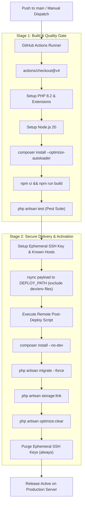

# 🚀 Production Deployment & CI/CD Guide

This guide details the automated CI/CD pipeline, server provisioning, security hardening, and deployment configuration for **Lokaa**.

---

## 🏗️ Deployment Architecture Flow

The automated GitHub Actions workflow (`.github/workflows/deploy.yml`) coordinates testing, building, and secure synchronization over encrypted SSH/rsync.



---

## 🔑 Required GitHub Secrets and Variables

Configure these settings in your repository under **Settings > Secrets and variables > Actions**.

### Repository Secrets

| Secret Name | Type | Purpose | Example Placeholder |
| :--- | :--- | :--- | :--- |
| `SSH_HOST` | Secret | Production server hostname or public IP address | `deploy.example.com` |
| `SSH_USER` | Secret | Dedicated unprivileged deployment user on target host | `deployer` |
| `SSH_PORT` | Secret | SSH daemon port (default: 22) | `22` |
| `SSH_PRIVATE_KEY` | Secret | Ed25519 or RSA private SSH key for authentication | `<raw-private-key-file-contents>` |
| `SSH_KNOWN_HOSTS` | Secret | Output of `ssh-keyscan` for host key validation | `deploy.example.com ssh-ed25519 AAAAC3...` |

### Repository Variables

| Variable Name | Type | Purpose | Example Placeholder |
| :--- | :--- | :--- | :--- |
| `DEPLOY_PATH` | Variable | Target absolute filesystem directory on production server | `/var/www/lokaa` |
| `PHP_VERSION` | Variable | Target PHP version installed on runner | `8.2` |
| `NODE_VERSION` | Variable | Node.js engine version for building Vite assets | `20` |

---

## 🛠️ Step-by-Step Setup Guide

### 1. Generating a Dedicated Deploy SSH Key Pair

Run the following command on your local machine or bastion host:

```bash
ssh-keygen -t ed25519 -C "github-actions-deploy@lokaa" -f ./lokaa_deploy_key
```

1. Add the **public key** (`lokaa_deploy_key.pub`) to `~/.ssh/authorized_keys` of the `deployer` user on your production server.
2. Add the **private key** (`lokaa_deploy_key`) to GitHub Secrets as `SSH_PRIVATE_KEY`.
3. Never reuse personal SSH keys for automation.

### 2. Capturing `SSH_KNOWN_HOSTS`

Prevent MITM (Man-In-The-Middle) attacks by scanning and pinning the server host key:

```bash
ssh-keyscan -p 22 deploy.example.com
```

Copy the resulting fingerprint string directly into the `SSH_KNOWN_HOSTS` repository secret.

---

## 🖥️ Server Infrastructure Configuration

### 1. Nginx Virtual Host Configuration

```nginx
server {
    listen 80;
    server_name example.com www.example.com;
    return 301 https://$server_name$request_uri;
}

server {
    listen 443 ssl http2;
    server_name example.com www.example.com;

    root /var/www/lokaa/public;
    index index.php index.html;

    ssl_certificate /etc/letsencrypt/live/example.com/fullchain.pem;
    ssl_certificate_key /etc/letsencrypt/live/example.com/privkey.pem;

    client_max_body_size 25M;

    location / {
        try_files $uri $uri/ /index.php?$query_string;
    }

    location ~ .php$ {
        fastcgi_pass unix:/var/run/php/php8.2-fpm.sock;
        fastcgi_param SCRIPT_FILENAME $document_root$fastcgi_script_name;
        include fastcgi_params;
    }

    location ~ /.(?!well-known).* {
        deny all;
    }

    location ~* .(js|css|png|jpg|jpeg|gif|ico|svg|webp|woff|woff2)$ {
        expires 30d;
        add_header Cache-Control "public, immutable";
    }
}
```

### 2. Supervisor Configuration for Queue Worker

Create `/etc/supervisor/conf.d/lokaa-worker.conf`:

```ini
[program:lokaa-worker]
process_name=%(program_name)s_%(process_num)02d
command=/usr/bin/php /var/www/lokaa/artisan queue:work --sleep=3 --tries=3 --max-time=3600
autostart=true
autorestart=true
stopasgroup=true
killasgroup=true
user=www-data
numprocs=2
redirect_stderr=true
stdout_logfile=/var/www/lokaa/storage/logs/queue.log
stdout_logfile_maxbytes=10MB
```

Load and start the worker daemon:

```bash
sudo supervisorctl reread
sudo supervisorctl update
sudo supervisorctl start lokaa-worker:*
```

### 3. Cron Scheduler

Add Laravel's scheduler heartbeat to crontab:

```bash
echo "* * * * * cd /var/www/lokaa && php artisan schedule:run >> /dev/null 2>&1" | sudo crontab -u www-data -
```

---

## 🔒 Security Hardening & Best Practices

1. **Dedicated Deployment User:** Deployments run under an unprivileged user (`deployer`) belonging to the `www-data` group, not `root`.
2. **Environment Variable Segregation:** Production credentials reside exclusively in `/var/www/lokaa/.env` on the host (with `chmod 600`). No `.env` file is ever checked into source control or transferred across the network.
3. **Storage Symlink Isolation:** Public file uploads are isolated in `storage/app/public` and symlinked via `php artisan storage:link` to avoid exposing application code.
4. **Key Rotation Protocol:** Rotate SSH keys and external API credentials every 90 days. Revoke compromised keys immediately from `~/.ssh/authorized_keys`.
5. **Zero Sensitive Data in Builds:** Build logs, test logs, and temporary keys are destroyed immediately upon workflow completion through GitHub Actions `always()` cleanup blocks.
